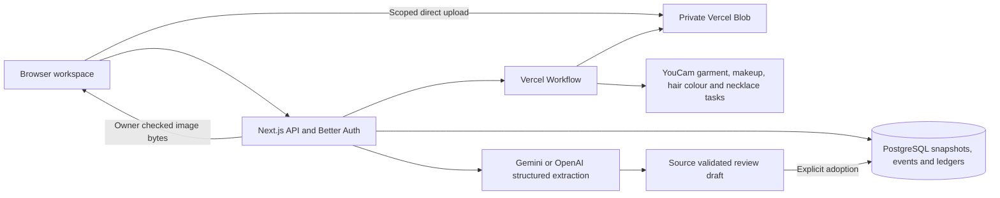

# Implemented architecture

STAGECRAFT connects versioned costume appearance evidence with a production's scenes, physical units, schedule, sourcing records and crew packs. The shipped production is fictional. Actual YouCam outputs are labelled separately from source artwork, operator approvals and physical evidence.

## Runtime and boundaries

The application uses Next.js 16.4.3, React 19.3.1, TypeScript 5.9.3, Node.js 22, Better Auth 1.7.14, `pg` 8.23.1, `@vercel/blob` 2.8.2 and Workflow 5.2.3. Package versions and the pnpm lockfile are checked into the repository. PostgreSQL 18.4 is used for local verification; the deployed database is a separate managed Neon resource.

Better Auth creates an anonymous owner for a browser. Its cookies use the `stagecraft` prefix, distinct from STEADY. This release has one owner per production; named reviewers and manual sourcing operators are owner-entered evidence records. They are not independently authenticated supplier identities or a collaboration/RBAC system. Every project, draft, job and private image endpoint checks the owner on the server.

Browser bootstrap creates an anonymous identity only after a successful session read returns literal `null`. Rate limits, network errors, malformed replies and server errors preserve the existing cookie and saved preview intents. One GET-only retry may honor an explicit `X-Retry-After` or `Retry-After` of up to 60 seconds; otherwise the owner receives a recoverable message. An uncertain anonymous sign-in POST is never automatically repeated. Parallel bootstrap calls share the same pending check.

The API checks mutation origins, bounds streamed JSON bodies, validates strict Zod schemas and limits uploads, model requests, commands and reads. Only exact shipped source paths or validated assets belonging to the same owner, production and subject may be attached. Public commands cannot create provider previews, extracted scripts, prefilled appearance approvals or arbitrary remote image URLs. Errors contain fixed messages rather than provider bodies, credentials or signed URLs.

## Production changes

`src/lib/domain` owns the deterministic production model, allocation checker, change impact and repair rules. Story chronology remains separate from dated occurrences. A physical unit is an individual resource. Appearance approval references an exact performer, capture, recipe and preview; fitting, availability and supplier evidence remain separate.

An accepted command locks the production row inside a PostgreSQL transaction, checks its expected revision and records an immutable snapshot, append-only domain events and the command identity. Repeating an identical command returns its original result. Reusing the identity for a different command fails. Concurrent different edits and stale repair/allocation adoptions fail rather than overwrite newer facts.

Working copies have at most 500 revisions and a 1.5 MB current JSON snapshot. The production list returns small summaries. A named-owner export contains the current production and a revision manifest; frozen historical snapshots are downloaded individually through owner-checked endpoints. Their hashes cover the exact UTF-8 PostgreSQL JSONB text returned by the download endpoint. They are not hashes of a differently formatted JSON document.

Appearance candidates store an immutable performer/capture, garment recipe and continuity scope. Provider input identity is separate from approval intent: unchanged submitted pixels can be reused after a direction edit, while the changed direction requires a new approval. Candidate previews use the first scoped look and immutable recipe revision 1 even when requested from a later-day look or after adoption. Approval and solver adoption retain the candidate lineage; revocation invalidates dependent decisions. Public requests supply a candidate identity, and the server resolves its saved recipe. They cannot supply a preview or provider provenance.

Allocation separates missing decisions from physical conflicts. `DECISIONS_NEEDED` counts unique dressed looks used by scheduled calls, excluding unscheduled and Own clothes roles. It never assigns an unapproved choice. A diagnostic check still reports actual budget, availability and overlap conflicts as `INFEASIBLE`. Older saved approval-only infeasible results display the new state without rewriting historical production data.

Each solution records the original recipes, coherent garment swaps and comparative choices. Adoption of a swap requires a server-validated confirmation bound to the proposal ID, allocation input hash, source revision and current review hash. Re-solving identical inputs creates a new proposal and invalidates prior confirmation. The review hash includes candidate scope, current revision and creative direction. Removed-item references remain visible after adoption and subsequent solves until the direction is corrected or the original unit is restored. Quote comparisons cost each physical unit once and hold the other saved assignments fixed; they are not claims about a new globally optimized counterfactual.

## Actual YouCam processing

The implemented garment operation is `POST /s2s/v2.0/task/cloth-v4`, followed by status reads at the matching task endpoint. One source person and one garment reference are registered through the file API and uploaded using its returned method and headers. `outerwear` maps to the provider's `outer` value; `change_shoes` is false and `filter_multi_person` is `strict`. The provider bearer is never forwarded to a signed storage destination. [Official Clothes V4 schema](https://docs.makeupar.com/reference/ai_clothes/v4.0), [file workflow](https://docs.makeupar.com/reference/ai_clothes/section/overview).

Jobs persist normalized input hashes, recipe/capture binding, estimated units, file-registration intents, uploaded file identities, submission intent and provider task identity. Workflow receives only the application job ID. Steps reload transport data privately from PostgreSQL. File preparation and status/download operations can recover; the paid task POST has no automatic retry. A lost response or interrupted submission without a saved task identity becomes `ambiguous`. A known task can be resumed without creating a second paid task.

Polling starts at ten seconds, then backs off. A successful output is decoded, normalized and written to private Blob before its asset, preview and completed job are committed atomically. The current source/recipe is rechecked before attachment. A changed input cancels attachment. Provider success does not create an appearance approval.

Seven public recordings were generated from the fictional adult artwork and garment references. The observed shared balance changed from 1,028 to 1,014 units: seven successful tasks, no failed or ambiguous submission. Their manifest includes source, upload and result SHA-256 hashes and hashed task evidence. Recordings match the exact performer, source bytes, garment bytes, unit and category; logical recipe/capture revisions are rebound to the current production. Old approvals are never carried forward. Public output images are WebP re-encodings without retouching. The [AI-assisted inspection record](evaluation-ai.md) describes visible garment variations and its limits.

The original thirteen synthetic source/profile pairs and four review additions ship the exact JPEG bytes used for recording. Separate registries preserve the original manifest. The public-fixture loader requires the allowlisted source path, exact raw source SHA-256 and correct body/face profile, then verifies the frozen JPEG's recorded upload hash and JPEG dimensions. It does not re-encode a fixture at runtime. Missing or changed evidence fails closed. This removes runtime JPEG encoder dependence without weakening recording matching; private uploads retain their normal decode, EXIF removal and normalization path. A production recording mismatch prompted this change; its underlying cause was not independently established, and a resized private upload is not evidence of a same-input codec difference.

Explicit sample-library imports set trusted source identities on the imported performer, face capture and physical unit. A nonfixture project cannot obtain that identity by choosing a fixture's ID or image path. Recording reuse requires those trusted bindings, exact source/reference transport hashes, category and submitted effects. A different physical unit or day look may reference identical verified provider inputs; the new preview records the original recording evidence and the current recipe identity, with no inherited approval. Source replacement clears the affected library identity.

Authenticated `GET /api/library` derives Ready preview badges from the same verified source, transport, recipe and output identities used by recording attachment. A project-scoped request also checks ownership, capture permission and trusted imported bindings. Its 18 physical-unit bindings reuse 12 actual garment outputs; identical ivory artwork does not merge the three physical units. Unsupported pair suggestions favor the selected performer and compatible category. A performer change requires an explicit library selection. The client cancels obsolete checks when the production revision or pair changes, and new-look creation waits for the current check before deciding whether to attach a recording. This read path neither submits provider tasks nor checks fresh-generation balance.

The separate beauty operation uses `POST /s2s/v2.0/task/makeup-vto` with one explicitly permitted face capture, version `1.0` and a deterministic supported matte blush/lip recipe. Both `skinSmoothStrength` and `skinSmoothColorIntensity` are zero, the lip shape is `original`, and lip fullness/wrinkless are zero. These are payload settings, not a guarantee about identity, texture or rendering fidelity. The detail has independent face-capture and beauty-recipe versions, source hash, previews and explicit approvals. A garment replacement can preserve beauty evidence; a recast invalidates performer-specific evidence in both views. The image is never composited into the body preview. [Official Makeup VTO schema](https://docs.makeupar.com/reference/makeup_vto/v1.0).

Two original recorded beauty details use separately generated Ada/Celeste face artwork and Nora's muted berry recipe. Both succeeded with no uncertain submission; the observed shared balance changed from 1,012 to 1,010 units. Their separate manifest records raw/transport/result hashes and exact effects.

Independent hair colour uses `POST /s2s/v2.0/task/hair-color` with a permitted face source and one supported full-colour preset. Necklace VTO uses `POST /s2s/v2.0/task/2d-vto/necklace`, a permitted face and a trusted pendant reference, with explicit background removal, shadow 0.15 and ambient 1. Both have their own recipe revisions, previews and approvals. Garment changes preserve them; face replacement, recasting or applicable consent withdrawal invalidates them. All four provider kinds use the same durable job and private-output path. No detail is composited into the body preview. Requested hair presets describe the request: the recorded Chocolate Brown result appears wine/plum and is flagged for inspection.

The review matrix added eleven actual tasks: five garment, two finale makeup, two hair colour and two necklace outputs. Eleven succeeded with no ambiguous submission, and the observed shared balance changed from 981 to 965 units. New manifests preserve the original recordings. A new example attaches eight garment looks, two makeup states, four independent details and two candidate alternatives, all without approvals. Images do not establish physical fit, product matching, movement comfort, supplier availability or a realized production outcome. The [recording summary](evidence/review-recording-summary.json) and [observed necklace response contract](evidence/necklace-task-contract.json) contain sanitized evidence.

Live jobs share a default eight-job UTC daily allowance and four-job owner allowance. A PostgreSQL cache checks the upstream balance through a read-only GET at most once per five minutes after success, or thirty seconds after failure. The default floor is 200 units; outstanding application reservations reduce available headroom, and an unavailable balance fails closed with a safe resting message. Recorded reuse is independent of this check. A terminal failed/cancelled reservation is released only when both the submission timestamp and provider task identity are absent. An ambiguous or accepted task stays charged. This ledger does not coordinate atomically with other applications sharing the provider account.

## Private images and retention

Uploads use a persisted, subject-scoped 15-minute intent and a bounded direct client token. Finalization checks owner, project, subject, byte count, MIME type and decoded dimensions. JPEG, PNG and single-frame WebP inputs below 10 MB are decoded with a pixel limit, oriented and encoded as a new JPEG without EXIF. Body/garment images fit within 2048 pixels; separate face captures fit within 1600 × 1000, without cropping, to satisfy the makeup endpoint's stricter size requirements. The app minimum is 512 pixels on the long side and 384 on the short side. It does not create a face capture by cropping a body image. Pose, face occupancy, identity and rights are not established by dimensions; the owner supplies permission and inspects the result.

Private Blob URLs are never stored in browser-visible production data. Images are delivered as bytes through owner-checked `/api/assets/:id` routes with private, noncached responses. Only licensed public fixture inputs are cached in process memory. Raw upload objects expire from the intake workflow and are removed by maintenance; normalized captures and results have a maximum 30-day authorization lifetime, bounded by the production's own lifetime.

Face-only permission withdrawal revokes the face source and makeup, hair and necklace jobs/outputs while preserving valid garment evidence. Performer-wide withdrawal and project deletion revoke both groups, cancel affected local work and start durable erasure. Private reads consult the corresponding current permission. Because an already issued Blob upload token cannot be revoked, the original deadline remains recorded. Erasure makes a second pass after 16 minutes before removing a deleted project's ledger. Daily maintenance catches expired projects, raw uploads and deferred erasures. Storage failures can delay physical removal and must be monitored; they do not restore image access.

YouCam's published retention is separate: uploaded/generated files and task identities last 30 days, and result links last two hours and can be refreshed using the task identity. Application deletion does not promise immediate upstream deletion; this integration has no provider deletion endpoint. [Provider retention](https://docs.makeupar.com/develop/file_retention_period).

## Script extraction

An owner-confirmed script is sent as untrusted data to configured Gemini 4 Argon, or GPT-6 Astra when Gemini is not configured. There are no model tools. The Gemini provider schema omits nested numeric/string/array bounds that caused an observed `INVALID_ARGUMENT`; the original strict Zod schema still enforces every bound locally, and OpenAI receives the full schema. The server maps normalized whitespace, curly quotes and Fountain heading markers back to untouched original UTF-16 offsets. Repeated quotes select the first matching occurrence with a notice. Invalid headings/cues are dropped and audited while valid parts remain reviewable; operational fields still fail strict parsing. An explicitly abbreviated quote can retain one sufficiently long exact contiguous excerpt, with its original quote, repaired excerpt and offsets flagged. All proposed scenes and requirements remain unreviewed. An unstated story day is explicitly marked `unspecified`; its provisional numeric value is not a chronology fact. [Gemini schema limitations](https://ai.google.dev/gemini-api/docs/structured-output#limitations), [OpenAI structured output](https://developers.openai.com/api/docs/guides/structured-outputs).

Extraction has a persisted request identity and a synchronous model call bounded at 90 seconds, within a 120-second route budget. An interrupted request is not automatically repeated; maintenance marks abandoned drafts failed. Explicit draft adoption checks the original production revision and delegates merging to the domain engine, preserving existing reviewed edits. Removing a scheduled scene blocks adoption with an actionable message. Model output cannot approve, reserve, measure or claim an external outcome.

The 60,000-character input cap is enforced before provider access; the current extractor sends one bounded document rather than claiming chunked unlimited input. The checked-in public-domain Act I fixture is 42,055 original UTF-16 code units, or 40,725 after LF normalization. Two actual Gemini attempts are preserved: the first grounded 6/9 proposed cues in 12.268 seconds; after the contiguous-quote prompt and explicit repair policy, the second grounded 8/8 in 11.473 seconds, with no repair needed. All retained source spans matched the original text. This measures grounding of proposed cues, not recall of every costume cue. See the [full attempt audit](evidence/script-import-review.json).

## Verification scope

Automated verification includes isolated PostgreSQL ownership/concurrency checks, immutable revision replay, stale proposal/draft rejection, cross-owner assets, revoked upload deadlines, spend caps surviving deletion, budget floor/cache/release rules, four-kind file/task restart recovery, lost paid responses, recorded candidate recovery, strict provider schemas, EXIF/MIME checks, partial source grounding and exact recording integrity. Provider and Blob calls in these tests are mocks. Actual provider evidence includes the original nine recordings and eleven review recordings. Local browser checks also completed fresh garment and beauty tasks through durable workflows and private output reads; the beauty check recovered across a browser reload without another submission. Deployed checks are documented separately. No participant, supplier or physical fitting result is implied.
