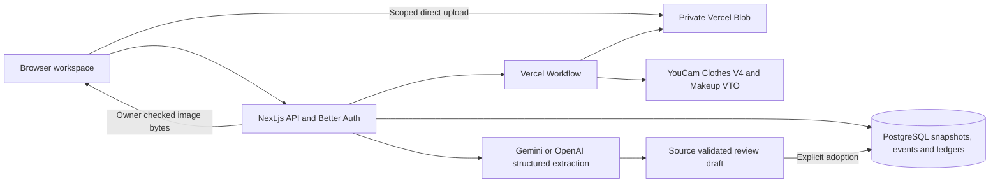

# Implemented architecture

STAGECRAFT connects versioned costume appearance evidence with a production's scenes, physical units, schedule, sourcing records and crew packs. The shipped production is fictional. Actual YouCam outputs are labelled separately from source artwork, operator approvals and physical evidence.

## Runtime and boundaries

The application uses Next.js 16.4.3, React 19.3.1, TypeScript 5.9.3, Node.js 22, Better Auth 1.7.14, `pg` 8.23.1, `@vercel/blob` 2.8.2 and Workflow 5.2.3. Package versions and the pnpm lockfile are checked into the repository. PostgreSQL 18.4 is used for local verification; the deployed database is a separate managed Neon resource.

Better Auth creates an anonymous owner for a browser. Its cookies use the `stagecraft` prefix, distinct from STEADY. This release has one owner per production; named reviewers and manual sourcing operators are owner-entered evidence records. They are not independently authenticated supplier identities or a collaboration/RBAC system. Every project, draft, job and private image endpoint checks the owner on the server.

The API checks mutation origins, bounds streamed JSON bodies, validates strict Zod schemas and limits uploads, model requests, commands and reads. Only exact shipped source paths or validated assets belonging to the same owner, production and subject may be attached. Public commands cannot create provider previews, extracted scripts, prefilled appearance approvals or arbitrary remote image URLs. Errors contain fixed messages rather than provider bodies, credentials or signed URLs.

## Production changes

`src/lib/domain` owns the deterministic production model, allocation checker, change impact and repair rules. Story chronology remains separate from dated occurrences. A physical unit is an individual resource. Appearance approval references an exact performer, capture, recipe and preview; fitting, availability and supplier evidence remain separate.

An accepted command locks the production row inside a PostgreSQL transaction, checks its expected revision and records an immutable snapshot, append-only domain events and the command identity. Repeating an identical command returns its original result. Reusing the identity for a different command fails. Concurrent different edits and stale repair/allocation adoptions fail rather than overwrite newer facts.

Working copies have at most 500 revisions and a 1.5 MB current JSON snapshot. The production list returns small summaries. A named-owner export contains the current production and a revision manifest; frozen historical snapshots are downloaded individually through owner-checked endpoints. Their hashes cover the exact UTF-8 PostgreSQL JSONB text returned by the download endpoint. They are not hashes of a differently formatted JSON document.

## Actual YouCam processing

The implemented garment operation is `POST /s2s/v2.0/task/cloth-v4`, followed by status reads at the matching task endpoint. One source person and one garment reference are registered through the file API and uploaded using its returned method and headers. `outerwear` maps to the provider's `outer` value; `change_shoes` is false and `filter_multi_person` is `strict`. The provider bearer is never forwarded to a signed storage destination. [Official Clothes V4 schema](https://docs.makeupar.com/reference/ai_clothes/v4.0), [file workflow](https://docs.makeupar.com/reference/ai_clothes/section/overview).

Jobs persist normalized input hashes, recipe/capture binding, estimated units, file-registration intents, uploaded file identities, submission intent and provider task identity. Workflow receives only the application job ID. Steps reload transport data privately from PostgreSQL. File preparation and status/download operations can recover; the paid task POST has no automatic retry. A lost response or interrupted submission without a saved task identity becomes `ambiguous`. A known task can be resumed without creating a second paid task.

Polling starts at ten seconds, then backs off. A successful output is decoded, normalized and written to private Blob before its asset, preview and completed job are committed atomically. The current source/recipe is rechecked before attachment. A changed input cancels attachment. Provider success does not create an appearance approval.

Seven public recordings were generated from the fictional adult artwork and garment references. The observed shared balance changed from 1,028 to 1,014 units: seven successful tasks, no failed or ambiguous submission. Their manifest includes source, upload and result SHA-256 hashes and hashed task evidence. Recordings match the exact performer, source bytes, garment bytes, unit and category; logical recipe/capture revisions are rebound to the current production. Old approvals are never carried forward. Public output images are WebP re-encodings without retouching. The [AI-assisted inspection record](evaluation-ai.md) describes visible garment variations and its limits.

The separate beauty operation uses `POST /s2s/v2.0/task/makeup-vto` with one explicitly permitted face capture, version `1.0` and a deterministic supported matte blush/lip recipe. Both `skinSmoothStrength` and `skinSmoothColorIntensity` are zero, the lip shape is `original`, and lip fullness/wrinkless are zero. These are payload settings, not a guarantee about identity, texture or rendering fidelity. The detail has independent face-capture and beauty-recipe versions, source hash, previews and explicit approvals. A garment replacement can preserve beauty evidence; a recast invalidates performer-specific evidence in both views. The image is never composited into the body preview. [Official Makeup VTO schema](https://docs.makeupar.com/reference/makeup_vto/v1.0).

Two actual recorded beauty details use separately generated Ada/Celeste face artwork and Nora's muted berry recipe. Both succeeded with no uncertain submission; the observed shared balance changed from 1,012 to 1,010 units. Their separate manifest records raw/transport/result hashes and exact effects. Clothes V4 does not render makeup, hair or accessories; the independent Makeup VTO detail renders the supported blush/lip recipe. Hair and accessory notes remain practitioner direction. Neither view establishes physical fit, product matching, movement comfort, supplier availability or a realized production outcome.

## Private images and retention

Uploads use a persisted, subject-scoped 15-minute intent and a bounded direct client token. Finalization checks owner, project, subject, byte count, MIME type and decoded dimensions. JPEG, PNG and single-frame WebP inputs below 10 MB are decoded with a pixel limit, oriented and encoded as a new JPEG without EXIF. Body/garment images fit within 2048 pixels; separate face captures fit within 1600 × 1000, without cropping, to satisfy the makeup endpoint's stricter size requirements. The app minimum is 512 pixels on the long side and 384 on the short side. It does not create a face capture by cropping a body image. Pose, face occupancy, identity and rights are not established by dimensions; the owner supplies permission and inspects the result.

Private Blob URLs are never stored in browser-visible production data. Images are delivered as bytes through owner-checked `/api/assets/:id` routes with private, noncached responses. Only licensed public fixture inputs are cached in process memory. Raw upload objects expire from the intake workflow and are removed by maintenance; normalized captures and results have a maximum 30-day authorization lifetime, bounded by the production's own lifetime.

Face-only permission withdrawal revokes the face source, beauty outputs and beauty jobs while preserving valid garment evidence. Performer-wide withdrawal and project deletion revoke both groups, cancel affected local work and start durable erasure. Private reads consult the corresponding current permission. Because an already issued Blob upload token cannot be revoked, the original deadline remains recorded. Erasure makes a second pass after 16 minutes before removing a deleted project's ledger. Daily maintenance catches expired projects, raw uploads and deferred erasures. Storage failures can delay physical removal and must be monitored; they do not restore image access.

YouCam's published retention is separate: uploaded/generated files and task identities last 30 days, and result links last two hours and can be refreshed using the task identity. Application deletion does not promise immediate upstream deletion; this integration has no provider deletion endpoint. [Provider retention](https://docs.makeupar.com/develop/file_retention_period).

## Script extraction

An owner-confirmed script is sent as untrusted data to configured Gemini 4 Argon, or GPT-6 Astra when Gemini is not configured. There are no model tools. The Gemini provider schema omits nested numeric/string/array bounds that caused an observed `INVALID_ARGUMENT`; the original strict Zod schema still enforces every bound locally, and OpenAI receives the full schema. The server derives source offsets from exact scene headings and unambiguous quotes, generates IDs and rejects invented spans or operational fields. All proposed scenes and requirements remain unreviewed. An unstated story day is explicitly marked `unspecified`; its provisional numeric value is not a chronology fact. [Gemini schema limitations](https://ai.google.dev/gemini-api/docs/structured-output#limitations), [OpenAI structured output](https://developers.openai.com/api/docs/guides/structured-outputs).

Extraction has a persisted request identity and a synchronous model call bounded at 90 seconds, within a 120-second route budget. An interrupted request is not automatically repeated; maintenance marks abandoned drafts failed. Explicit draft adoption checks the original production revision and delegates merging to the domain engine, preserving existing reviewed edits. Removing a scheduled scene blocks adoption with an actionable message. Model output cannot approve, reserve, measure or claim an external outcome.

## Verification scope

Automated verification includes isolated PostgreSQL ownership/concurrency checks, immutable revision replay, stale proposal/draft rejection, cross-owner assets, revoked upload deadlines, spend caps surviving deletion, file/task restart recovery, lost paid responses, result commit replay, strict provider schemas, EXIF/MIME checks, source-span validation and recording integrity. Provider and Blob calls in these tests are mocks; actual provider evidence includes the seven garment recordings and two separate beauty recordings. Local browser checks also completed one fresh garment task and one fresh beauty task through durable workflows and private output reads; the beauty check recovered across a browser reload without another submission. Deployed checks are documented separately. No participant, supplier or physical fitting result is implied.
